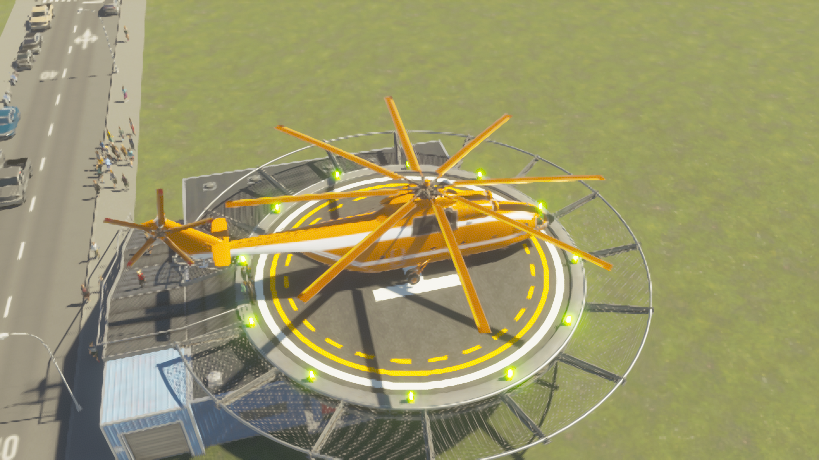

# CS2 Passenger Helicopters

[简体中文](README.md) | [English](README.en.md)

An operational passenger-helicopter system for Cities: Skylines II, featuring a twin-pad heliport, a standalone rooftop helipad, and the Mil Mi-26TC passenger helicopter.

[](https://mods.paradoxplaza.com/mods/165769/Windows)
[](LICENSE)



## Features

- Create, inspect, and manage passenger-helicopter lines
- Twin-pad heliport and standalone rooftop helipad
- Aircraft selection, vehicle allocation, fares, and operating hours
- Takeoff and landing queues, passenger boarding, walking connections, and depot returns
- City save and restore support
- Mil Mi-26TC with 60 seats and a maximum cruise speed of 350 km/h
- Simplified Chinese and English UI

## Installation

The recommended installation method is to subscribe on [Paradox Mods](https://mods.paradoxplaza.com/mods/165769/Windows):

1. Add the mod to your active playset.
2. Wait for the download to finish and restart the game when prompted.
3. Open **Transportation → Passenger Helicopters** to start building.

Do not install local and subscribed copies at the same time, as this can load the runtime twice. The mod does not require CityWeaver MCP, Node.js, or an AI client during play.

## Quick start

1. Build a roadside heliport with a depot.
2. Place another heliport or standalone helipad and connect each facility to roads and pedestrian paths.
3. Starting at the depot heliport's boarding point, connect the stops and return to the first stop to form a closed line.
4. Select the Mil Mi-26TC in the line details and assign the desired number of aircraft.

The two pads at a heliport can serve separate lines. See the [English player guide](PLAYER-GUIDE.en.md) for more details.

## Development

### Requirements

- Windows
- .NET SDK 8
- .NET Runtime 6.0.36
- Cities: Skylines II and the official Modding Toolchain
- Node.js 20 or later for tests and packaging
- Git LFS for the final native assets
- The `CSII_*` environment variables configured by the game toolchain

Pull the LFS-managed assets after cloning for the first time:

```powershell
git lfs install
git lfs pull
```

### Build and test

```powershell
./build.ps1 -Configuration Release -Stage
npm test
```

`-Stage` writes build output under this project's `artifacts/` directory without installing it into the game.

Create a local installation package and verify it without making changes:

```powershell
node package.mjs --output artifacts/packages/PassengerHelicopters-local
./artifacts/packages/PassengerHelicopters-local/Install.ps1 -VerifyOnly
```

The game cannot hot-reload a loaded DLL. Exit the game before installing and testing a new build.

## Repository layout

| Path | Contents |
| --- | --- |
| `Runtime/` | Transport runtime and minimal save-compatibility layer |
| `Loader/` | Mod entry point |
| `assets/native/` | Final native game assets managed by Git LFS |
| `assets/helicopter/` | Lightweight publication material and asset provenance catalog |
| `Properties/` | Publication configuration, cover art, and screenshots |
| `test/` | Automated regression tests |
| `tools/` | Asset-processing tools |

Legacy assets serialize `CityWeaver.*` type identities, so the project retains a minimal compatibility assembly named `CityWeaver.dll`. Transport, model, rendering, and UI logic live in `TransportFever3Helicopters.Runtime.dll`; the mod entry assembly is `PassengerHelicopters.dll`. None of these assemblies contains an MCP service.

## Documentation

- [English player guide](PLAYER-GUIDE.en.md)
- [Publication workflow](PUBLICATION.md)
- [Changelog](CHANGELOG.md)
- [Model and asset credits](CREDITS.md)

## License and disclaimer

Source code is released under the [Apache License 2.0](LICENSE). See [CREDITS.md](CREDITS.md) for third-party model and asset provenance; their respective rights remain with their owners.

This is a community-made mod and is not affiliated with or endorsed by Colossal Order, Paradox Interactive, or Urban Games.

Original exports and intermediate asset-conversion output are not stored in Git; they can be regenerated with the existing toolchain. Publication builds depend only on the final assets under `assets/native/ImportedData`.

Mod-upload accounts, authentication data, publication configuration, and internal upload records are excluded from the repository. Supply an untracked local configuration with `--publish-config <path>` or `CSII_PUBLISH_CONFIG` when publishing.
